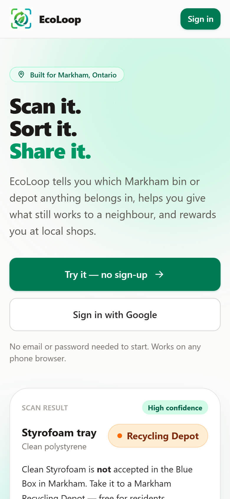
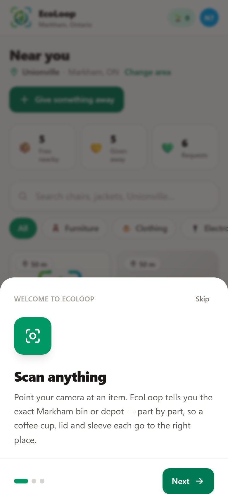
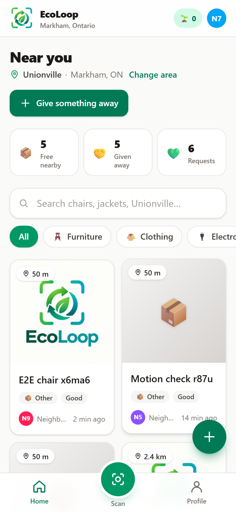
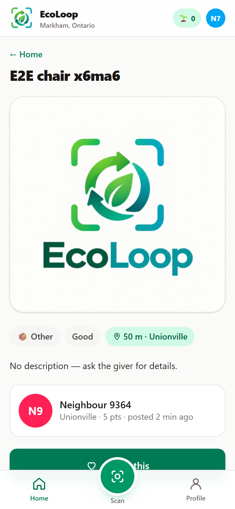
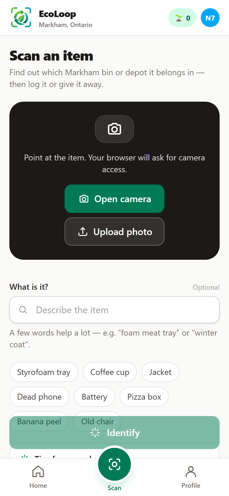
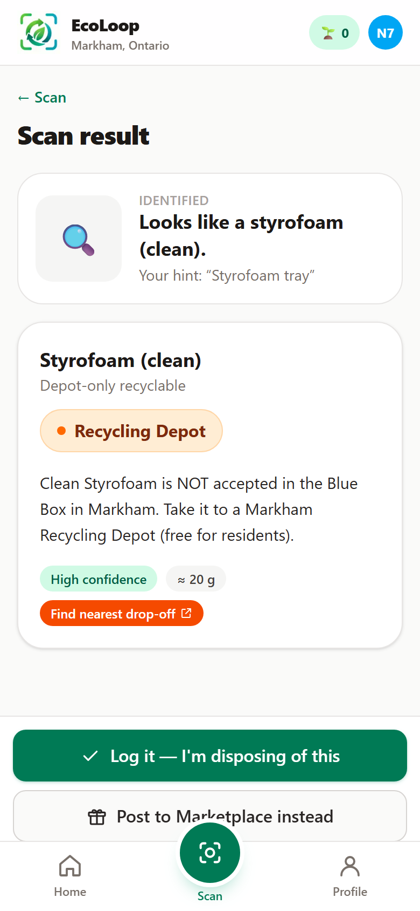
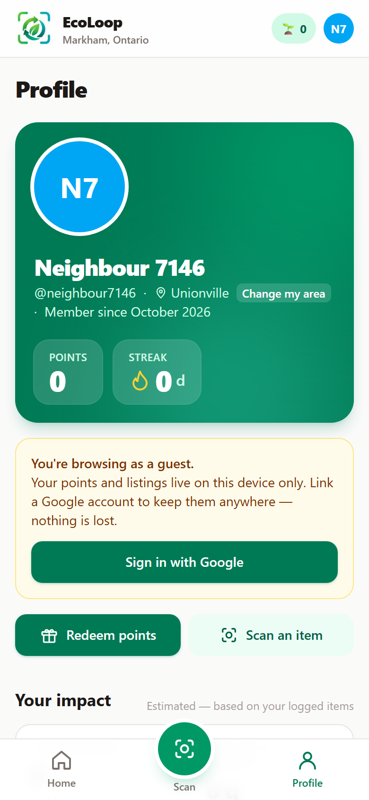
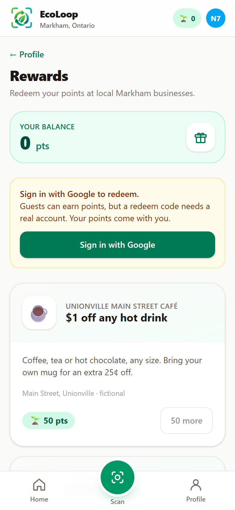

# EcoLoop

**Scan it. Sort it. Share it.** A waste-reduction app for Markham, Ontario.

Point your camera at anything and EcoLoop tells you which Markham bin or depot it belongs in,
part by part. If it still works, post it free to neighbours nearby and confirm the handover with
a photo. Logging and real handovers earn points you can redeem at local shops.

Live: **https://ecoloopmarkham.netlify.app** · Built for the GDG Markham civic-tech hackathon
(waste-reduction track), then polished to run entirely on free hosting.

| Landing | Walkthrough | Feed | Post |
|---|---|---|---|
|  |  |  |  |

| Scan | Scan result | Profile | Rewards |
|---|---|---|---|
|  |  |  |  |

## What it does

1. **Scan.** Camera or upload. Gemini identifies the item (or reads a receipt) against Markham's
   "What Goes Where" rules and returns one card per part: Blue Box, Green Bin, garbage, textile
   bin, recycling depot, hazardous-waste depot, yard waste, bulky pickup or retailer take-back,
   with a confidence label and a drop-off link where relevant. No AI? A searchable picker over
   the same 146 rules takes over.
2. **Log or share.** "Log it" records the disposal and awards points. "Post to Marketplace"
   pre-fills a free listing with the photo.
3. **Marketplace.** Listings sorted by distance from your neighbourhood. Tap "I want this"; the
   owner confirms the pickup with a handover photo and both sides earn points.
4. **Profile and rewards.** Items and kilograms diverted against the City's 80% target, your log,
   your listings, and fictional local rewards redeemed with a 6-character code.

Guests get in with one tap. Linking a Google account later keeps the same profile and points.

## Architecture

Everything runs in one Next.js app on Netlify's free tier. There is no server of our own.

```
  Browser (phone or desktop)
  ┌──────────────────────────────────────────────────────────────────┐
  │  Next.js 15 (App Router, TypeScript, Tailwind v4)  — frontend/    │
  │                                                                  │
  │  Firebase Auth ──── Google sign-in, anonymous "guest", linking    │
  │  Firestore (client SDK) ── users, posts, claims, logs, ledger,    │
  │        │                    redemptions · live onSnapshot feeds   │
  │        └── firestore.rules ── who may write what                  │
  │  Cloudinary (unsigned preset) ── listing + handover photos        │
  │  /api/scan (route handler, Node) ──► Gemini                       │
  │        key stays server-side · 8 s budget · {fallback:true}       │
  └──────────────────────────────────────────────────────────────────┘
  data/markham_rules.json (146 items) ◄── python/scripts/validate_rules.py
```

Repository layout:

```
ecoloop/
├─ frontend/            the app (Next.js). src/app = routes, src/lib/data = data layer,
│                       src/lib/server = scan route internals, e2e/ = Playwright smoke tests
├─ data/                markham_rules.json, depots.json, seed/rewards.json
├─ python/              validate_rules.py (+ stub generator)
├─ docs/                SPEC.md (original spec + §13 what changed), screenshots/
├─ firestore.rules      security rules (deploy with the CLI or paste in the console)
├─ firebase.json, .firebaserc, firestore.indexes.json
└─ netlify.toml         build + Firebase Auth proxy redirects
```

Two data sources implement one interface (`src/lib/data/source.ts`): `firestore.ts` in production
and `local.ts` for **demo mode** — when no `NEXT_PUBLIC_FIREBASE_*` vars are set the app runs
entirely from localStorage with fictional neighbours, and says so on the login screen.

## Local setup

Prerequisites: Node 20+ (tested on 24), npm. Python 3.11+ only for the rules validator.

```powershell
cd frontend
npm install
Copy-Item .env.example .env.local      # fill in the values below (or leave Firebase blank for demo mode)
npm run dev                            # http://localhost:3000
```

Root shortcuts: `npm run dev`, `npm run build`, `npm run lint`, `npm run test:e2e`,
`npm run validate:rules`.

### Environment variables (`frontend/.env.local`, and Netlify → Site configuration → Environment variables)

| Variable | Where it comes from |
|---|---|
| `NEXT_PUBLIC_FIREBASE_API_KEY` | Firebase console → Project settings → Your apps → Web app |
| `NEXT_PUBLIC_FIREBASE_AUTH_DOMAIN` | same (`<project>.firebaseapp.com`; see *Custom auth domain* below) |
| `NEXT_PUBLIC_FIREBASE_PROJECT_ID` | same |
| `NEXT_PUBLIC_FIREBASE_APP_ID` | same |
| `NEXT_PUBLIC_FIREBASE_MESSAGING_SENDER_ID` | same |
| `NEXT_PUBLIC_CLOUDINARY_CLOUD_NAME` | Cloudinary dashboard |
| `NEXT_PUBLIC_CLOUDINARY_UPLOAD_PRESET` | Cloudinary → Settings → Upload → preset with **Unsigned** signing mode |
| `GEMINI_API_KEY` | Google AI Studio. Server-only; never sent to the browser |
| `GEMINI_MODEL` | default `gemini-flash-lite-latest` (lite models answer in ~1.5 s; full flash models often exceed Netlify's 10 s limit) |
| `NEXT_PUBLIC_DEFAULT_LAT` / `_LNG` | Markham Civic Centre fallback (defaults baked in) |

None of the `NEXT_PUBLIC_*` values are secrets: Firebase web config is public by design and an
unsigned Cloudinary preset can only upload.

### Firebase project (one-time)

1. **Authentication → Get started.** Enable **Google** (set a support email) and **Anonymous**.
2. **Authentication → Settings → Authorized domains:** keep `localhost`, add your Netlify domain.
3. **Firestore Database → Create database** (production mode, any region).
4. **Deploy the rules** — either paste [`firestore.rules`](firestore.rules) into Firestore → Rules
   → Publish, or from the repo root:
   ```powershell
   npx firebase-tools login
   npx firebase-tools deploy --only firestore:rules
   ```
   All queries use single-field indexes, so there is nothing else to deploy.
5. Optional, so the consent screen says "EcoLoop": Google Cloud console → Google Auth Platform →
   Branding (app name, logo, home page, privacy policy `https://<your-domain>/privacy`).

### Cloudinary (one-time)

Free plan, no card. Copy the **Cloud name** from the dashboard; under Settings → Upload → Upload
presets add one with **Signing mode: Unsigned** (optionally asset folder `ecoloop`). Firebase
Storage was not used because new Firebase projects require the paid Blaze plan to enable it.

### Deploy to Netlify

`netlify.toml` sets base `frontend`, build `npm run build`, publish `.next`, and the Next.js
plugin. Import the GitHub repo, add the environment variables from the table above, deploy.
Free-plan projects created after August 2026 show a "Powered by Netlify" badge; turn it off under
Project configuration → General → Powered by Netlify badge.

**Custom auth domain (recommended).** `netlify.toml` proxies `/__/auth/*` to Firebase. Set
`NEXT_PUBLIC_FIREBASE_AUTH_DOMAIN` to your Netlify domain (e.g. `ecoloopmarkham.netlify.app`) and
add that domain to Firebase's authorized domains. The Google sign-in window then shows your domain
instead of `<project>.firebaseapp.com`, and the redirect fallback works on iOS browsers that block
third-party storage. Update the project id in `netlify.toml` if you fork this for another project.

## Data model (Firestore)

| Collection | Doc | Written by |
|---|---|---|
| `users/{uid}` | name, handle, initials, avatarColor, photoURL, neighbourhood, location, locationSource, points, streakCount, lastActiveDate, isGuest, onboardedAt, joinedAt | the user (rules pin `isGuest` to the real sign-in provider) |
| `posts/{id}` | ownerId, title, description, category, condition, photoURL, location, neighbourhood, status, claimCount, claimerId, pickupPhotoURL, pointsAwarded, pickedUpAt, createdAt | owner; anyone may bump `claimCount` by exactly 1 |
| `posts/{id}/claims/{uid}` | userId, createdAt | the claimer; readable by claimer + owner |
| `logs/{id}` | userId, itemName, stream, binLabel, estWeightG, diverted, createdAt | the user |
| `ledger/{id}` | userId, delta, reason, refId, createdAt | the user, delta bounded per reason |
| `redemptions/{id}` | userId, rewardId, code, createdAt | the user (Google-linked only) |

The rewards catalogue is static JSON (`src/lib/rewards.ts`, fictional businesses).

## Points and anti-farming

All rules live in `frontend/src/lib/points.ts`; `firestore.rules` enforces what it can.

| Action | Points | Limit |
|---|---|---|
| Log a diverted item / garbage | +5 / +1 | 50 log points per day |
| Create a listing | +5 | first 3 listings per day |
| Confirm a handover (giver / receiver) | +25 / +15 | **both accounts must be Google-linked** (rules); same pair once per 30 days; 3 given and 3 received per day; 5 handover credits per rolling week |
| 7-day streak | +20 | once per 7 days |
| Redeem a reward | −cost | Google-linked accounts only (rules) |

The item always changes hands; only points are withheld, and the UI says why.

## Tests

```powershell
cd frontend
npx playwright install chromium        # once
npm run build
npm run test:e2e                       # starts the production build on :3100 and runs e2e/*.spec.ts
```

Three smoke tests: guest sign-in renders the feed; a post with a photo appears in the feed; a scan
with no AI key falls back to the "help us identify" picker. They create guest users and one
listing, so point `frontend/.env.local` at a **separate Firebase test project** (or leave the
Firebase vars empty to run them in demo mode). The Firestore emulator also works
(`npx firebase-tools emulators:start --only firestore,auth`, requires Java) if you point the
client at it; the app does not do that automatically. `E2E_BASE_URL` runs the tests against any
already-running server.

Also useful: `python python/scripts/validate_rules.py`.

## Known limits

- **Points are client-computed.** Rules bound deltas, require real handovers between Google-linked
  accounts and pin `isGuest` to the real provider, but a determined user could still inflate their
  own balance. The production path is a Cloud Function (Blaze plan) that owns every ledger write.
- **Gemini free tier** is roughly 20 requests per day per model. The route falls through several
  lite models, then flash, then answers `{ fallback: true }`; results are cached per photo in the
  session. Add billing to the AI Studio project before a public event.
- **Rules knowledge base is unverified.** Every entry in `data/markham_rules.json` carries
  `"verified": false` until checked against markham.ca "What Goes Where". `npm run validate:rules`
  prints the count.
- **Rate limiting is per function instance.** The scan limiter (10 scans, +1 per minute, per
  user) resets on cold start. Good enough for a hackathon; use a shared store for more.
- **Bundle size.** App pages ship Firebase Auth + Firestore (~400 kB raw, ~130 kB gzipped shared).
  The landing page avoids them entirely (Lighthouse mobile 89). A thinner Firestore story
  (e.g. server components + a session cookie) would be the next step.
- **Guest data lives on one device** until the guest links Google.

## Credits

Built by the EcoLoop team for GDG Markham. Sorting guidance drafted from City of Markham public
information; verify against markham.ca before relying on it. Businesses in the rewards catalogue
are fictional.
